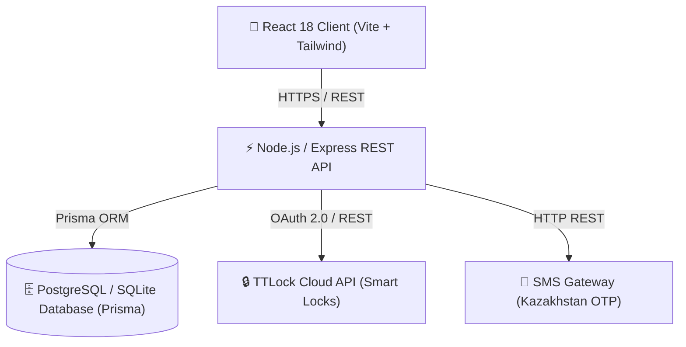

# 🏗️ Igraem.kz — Архитектурная документация (System Architecture)

> **Система**: Igraem.kz Platform Architecture  
> **Технологический стек**: Node.js, Express, Prisma ORM, PostgreSQL/SQLite, React 18, Vite, Tailwind CSS, TTLock Cloud API, GitHub Actions CI/CD  

---

## 1. Обзор архитектуры

Платформа Igraem.kz построена по принципу **модульного монолита** с четким разделением клиентской части (Client SPA) и серверной части (REST API Backend).



---

## 2. Структура репозитория и Модули

Код распределен по функциональным модулям в `client/src/features/` и серверным слоям в `src/`:

```
igraem.kz/
├── .github/
│   └── workflows/
│       ├── ci.yml                 # CI: Линтинг, проверки типов, модульные тесты
│       └── cd.yml                 # CD: Сборка Docker и автоматическое деплоймент-окружение
├── docs/
│   ├── BUSINESS_ANALYSIS.md       # Бизнес-требования, ролевая модель, прецеденты (BA)
│   ├── ARCHITECTURE.md            # Архитектура, схема БД, спецификация API
│   └── CICD_GUIDE.md              # Руководство по настройке CI/CD и деплою
├── client/                        # Фронтенд-приложение (React + Vite + Tailwind)
│   ├── src/
│   │   ├── components/            # Базовые UI-компоненты
│   │   ├── features/              # Модульная разбивка по фичам
│   │   │   ├── auth/              # Авторизация по SMS и профиль бана
│   │   │   ├── booking/           # Модалки бронирования, открытая сессия, TTLock
│   │   │   ├── map/               # Интерактивная карта и геолокация
│   │   │   ├── requests/          # Матчмейкинг и запросы игроков
│   │   │   ├── favorites/         # Избранные площадки
│   │   │   ├── profile/           # Настройки профиля и язык
│   │   │   └── layout/            # Шапка, навигация, логотип
│   │   ├── services/              # API клиенты и работы с хранилищем
│   │   └── types.ts               # Общие фронтенд интерфейсы
├── prisma/
│   ├── schema.prisma              # Модель данных Prisma
│   └── seed.ts                    # Сид-данные площадок и пользователей
├── src/                           # Бэкенд-сервер (Node.js + Express)
│   ├── config/                    # Конфигурация окружения и Prisma
│   ├── controllers/               # Контроллеры API (Auth, Grounds, Bookings)
│   ├── middlewares/               # Авторизация, валидация ИИН, ошибки
│   ├── routes/                    # Роутинг REST API
│   ├── services/                  # Бизнес-логика (TTLock, Cron Ban Engine)
│   └── utils/                     # Валидатор ИИН, гео-утилиты
├── Dockerfile                     # Сборка контейнера приложения
├── docker-compose.yml             # Оркестрация локального окружения
└── README.md                      # Главный разводящий файл проекта
```

---

## 3. Схема данных (Database Schema ERD)

```prisma
model User {
  id           String    @id @default(uuid())
  phone_number String    @unique
  full_name    String
  iin          String    @unique
  role         Role      @default(USER)
  is_banned    Boolean   @default(false)
  banned_until DateTime?
  created_at   DateTime  @default(now())

  bookings     Booking[]
  requests     Request[]
}

model Ground {
  id            String   @id @default(uuid())
  name          String
  type          SportType
  city          String
  address       String
  latitude      Float
  longitude     Float
  rating        Float    @default(5.0)
  lock_id       String?

  bookings      Booking[]
}

model Booking {
  id           String        @id @default(uuid())
  ground_id    String
  user_id      String
  booking_date String
  start_time   String
  end_time     String
  status       BookingStatus @default(UPCOMING)
  is_opened    Boolean       @default(false)

  ground       Ground        @relation(fields: [ground_id], references: [id])
  user         User          @relation(fields: [user_id], references: [id])
}
```

---

## 4. Спецификация REST API

### 4.1. Авторизация (`/api/v1/auth`)
* `POST /api/v1/auth/request-otp` — Запрос 4-значного SMS-кода на номер телефона.
* `POST /api/v1/auth/verify-otp` — Проверка кода из SMS. Возвращает JWT токен или флаг необходимости заполнения ИИН.
* `POST /api/v1/auth/complete-profile` — Заполнение Имени и ИИН для нового пользователя.

### 4.2. Площадки (`/api/v1/grounds`)
* `GET /api/v1/grounds` — Получение списка всех площадок с фильтрацией по спорту, городу и дате.
* `GET /api/v1/grounds/:id` — Детальная информация о площадке со свободной сеткой слотов.

### 4.3. Бронирования (`/api/v1/bookings`)
* `POST /api/v1/bookings` — Создание нового бронирования (проверка лимита 3 часа в день).
* `POST /api/v1/bookings/:id/unlock` — Отправка команды на отпирание смарт-замка TTLock.
* `POST /api/v1/bookings/:id/extend` — Продление аренды на 1 час (макс 2 раза).
* `POST /api/v1/bookings/:id/finish` — Завершение бронирования / освобождение площадки.

---

## 5. Спецификация интеграции TTLock Smart Lock

1. **Авторизация в Cloud API**: Использование `client_id` и `client_secret` для получения вендорского `access_token`.
2. **Отпирание замка**: Вызов эндпоинта `/v3/lock/unlock` с передачей `lockId`.
3. **Резервные PIN-коды**: При отсутствии интернет-соединения генерируется оффлайн клавиатурный PIN-код через алгоритм TTLock SDK.
