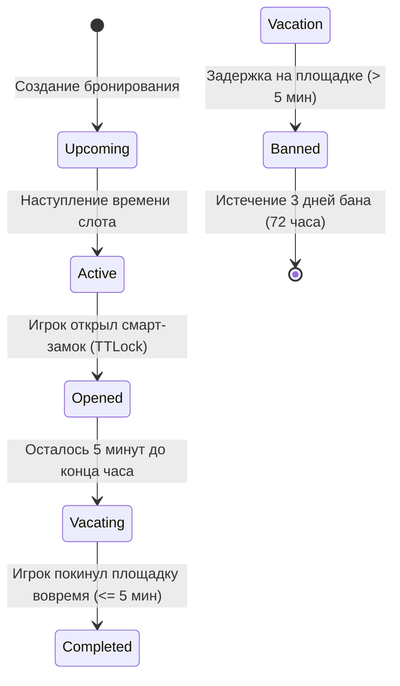

# 📊 Igraem.kz — Бизнес-анализ и спецификация требований (BA Specs)

> **Проект**: Igraem.kz (Автоматизированная система бронирования спортивных площадок и смарт-замков)  
> **Версия**: 2.0.0 (Production Architecture)  
> **Статус**: Утверждено / Готово к масштабированию  
> **Целевой рынок**: Казахстан (Темиртау, Караганда, Астана, Алматы)

---

## 1. Введение и Бизнес-цели

### 1.1. Проблема
В Казахстане любительский спорт (футбол, баскетбол) сталкивается с рядом системных проблем:
1. **Человеческий фактор и ручные администраторы**: Необходимость физического присутствия сторожа/администратора для открытия дверей площадки.
2. **Неэффективность бронирования**: Записи через мессенджеры, риск двойных броней (overbooking), отсутствие прозрачного расписания.
3. **Отказ от соблюдения регламента времени**: Игроки часто задерживаются после окончания забронированного часа, срывая следующие сеансы.
4. **Безопасность и идентификация**: Отсутствие прозрачной валидации личности приводит к порче имущества и неспортивному behavior.

### 1.2. Бизнес-решение (Igraem.kz)
Igraem.kz — единая мобильная веб-платформа, обеспечивающая **бесконтактную аренду спортивных площадок** с интегрированными смарт-замками TTLock:
* **Автоматизированный доступ**: Выдача временно ограниченных цифровых ключей/PIN-кодов TTLock.
* **Matchmaking & совместные игры**: Возможность организовывать открытые матчи и принимать запросы на присоединение других игроков.
* **Smart Overstay & Ban Engine**: Автоматический 3-дневный бан пользователей при задержке на площадке более чем на 5 минут после окончания аренды.
* **Верификация по ИИН**: Обязательное подтверждение личности по 12-значному ИИН Республики Казахстан для предотвращения фрода и повторных регистраций после бана.

---

## 2. Целевая аудитория и Пользовательские роли (Personas)

| Роль | Описание | Основные задачи |
| :--- | :--- | :--- |
| **Организатор (Owner)** | Пользователь, который забронировал и оплатил временной слот площадки. | Забронировать слот, открыть смарт-замок, продлить время, принимать/отклонять запросы игроков, завершить бронь. |
| **Участник (Participant)** | Игрок, отправивший запрос и получивший одобрение от Организатора. | Просмотреть карту, войти на площадку в назначенное время, видеть состав команд, покинуть площадку. |
| **Гость (Guest)** | Незарегистрированный пользователь. | Просмотр свободных площадок на карте, фильтрация по спорту/датам. Попытка брони переводит на SMS-авторизацию. |
| **Администратор площадки** | Владелец спортивного объекта. | Мониторинг бронирований, управлением замками TTLock, просмотр аналитики и отчетов. |
| **Служба поддержки** | Операторы техподдержки. | Обработка апелляций забаненных пользователей, решение экстренных вопросов. |

---

## 3. Функциональные требования (Functional Requirements)

### FR-01: Беспарольная SMS-авторизация и Валидация ИИН
* **FR-01.1**: Авторизация и вход выполняются строго по казахстанскому номеру телефона (`+7 (7XX) XXX-XX-XX`).
* **FR-01.2**: Для подтверждения номера отправляется 4-значный SMS OTP-код.
* **FR-01.3**: На экране ввода SMS-кода действует 60-секундный таймер повторной отправки (*«Отправить код повторно через 0:59»* -> по истечении 1 минуты активируется кнопка *«Отправить код повторно»*).
* **FR-01.4**: Если номер ранее зарегистрирован — происходит мгновенный вход.
* **FR-01.5**: Если номер новый — пользователь перенаправляется на форму заполнения личных данных (**Имя Фамилия** + **ИИН 12 цифр**).
* **FR-01.6**: ИИН проходит алгоритмическую валидацию (12 цифр, контрольная сумма, валидация даты рождения и века).

### FR-02: Интерактивная карта и Фильтрация
* **FR-02.1**: Отображение площадок на карте с геометками видов спорта (⚽ Футбол / 🏀 Баскетбол).
* **FR-02.2**: Вычисление расстояния от GPS-координат пользователя до площадки в реальном времени.
* **FR-02.3**: Переключение городов (Темиртау, Караганда, Астана, Алматы) с автоматическим центрированием карты.
* **FR-02.4**: Быстрая фильтрация по датам (Сегодня, Завтра, календарь) и временным слотам.

### FR-03: Бронирование и Правила слотов
* **FR-03.1**: Лимит бронирования — не более 3 часов на одного пользователя в день.
* **FR-03.2**: Занятые слоты выделяются тёплым жёлтым оттенком (`bg-[#FFF4E5] text-[#D97706]`).
* **FR-03.3**: Занятые слоты кликабельны: при выборе нажатие меняет кнопку на **«Присоединиться к игре»** с алертом: *«Этот слот занят, но вы можете отправить запрос чтобы присоединиться к этой игре»*.

### FR-04: Интеграция смарт-замков TTLock и Открытие площадки
* **FR-04.1**: При наступлении времени брони открывается доступ к отпиранию замка.
* **FR-04.2**: Процесс открытия сопровождается наглядным экраном загрузки (пульсирующие кольца, проверка геопозиции, отправка команды на замок).
* **FR-04.3**: После успешного отпирания статус бронируется как `isOpened = true`, а игрок фиксируется в списке участников со статусом **«Вошёл»**.

### FR-05: Активная сессия и Управление матчем (`VenueOpenedScreen`)
* **FR-05.1**: Отображение живого обратного отсчета времени до конца сеанса (сеанс длится 55 минут, 5 минут выделяется на освобождение).
* **FR-05.2**: Продление аренды: кнопка **«Продлить на 1 час»** расположенная над кнопкой «Открыть дверь» (максимум 2 продления по 1 часу при наличии свободных слотов).
* **FR-05.3**: Карточки действий: «Участники», «Правила пользования», «Сообщить о проблеме», «Открыть дверь».
* **FR-05.4**: Разграничение ролей в кнопке завершения:
  * **Организатор**: Кнопка **«Завершить бронирование»** -> Диалог *«Завершить бронирование?»* (*«Да, завершить»* / *«Отмена»*).
  * **Присоединившийся участник**: Кнопка **«Покинуть площадку»** -> Диалог *«Хотите покинуть площадку?»* (*«Да, покинуть»* / *«Отмена»*).

### FR-06: Совместные игры и Управление запросами (`RequestsTab`)
* **FR-06.1**: Раздел «Запросы» содержит подвкладки **«Мои запросы»** и **«Запросы мне»**.
* **FR-06.2**: В подвкладке «Запросы мне» отображаются карточки ТОЛЬКО тех площадок, на которые поступили запросы (`requests.length > 0`).
* **FR-06.3**: В детальном просмотре запросов панель информации о площадке выполнена на чистом белом фоне (`bg-white shadow-xs`).
* **FR-06.4**: Экран «Участники»: список игроков со статусами **«Вошёл»** (для прошедших через замок) и кнопками **«Отклонить»** (красный) / **«Принять»** (зелёный).

### FR-07: Система авто-бана и Защита от задержек (`BannedUserScreen`)
* **FR-07.1**: Если пользователь не покидает площадку в течение 5 минут после окончания времени аренды, его аккаунт автоматически блокируется в сервисе на 3 дня (72 часа).
* **FR-07.2**: Заблокированный пользователь получает полноэкранный блокирующий интерфейс в светлой дизайн-системе (`bg-slate-50`, `#00B050`, `bg-rose-50`).
* **FR-07.3**: Отображение обратного отсчета бана в формате: `X дн : Y ч : Z мин`.
* **FR-07.4**: Кнопка **«Связаться с техподдержкой»** открывает форму отправки письменного обращения без возможности телефонного звонка.

---

## 4. Бизнес-правила (Business Rules)

1. **BR-01 (Дата-формат)**: Все даты в интерфейсе отображаются строго с точечным разделителем (например, `14.10.2026`).
2. **BR-02 (Написание языка)**: Казахский язык обозначается исключительно как **`Қазақша`** с буквами `Қ`/`қ`.
3. **BR-03 (Единая типографика)**: Во всех сегмент-контроллах шрифты в активном и неактивном состоянии фиксированы как `font-semibold` с плавным белым ползунком-индикатором.

---

## 5. Матрица прослеживаемости требований (Traceability Matrix)

| ID Требования | Модуль | Файл реализации | Статус |
| :--- | :--- | :--- | :--- |
| **FR-01** | Auth | `client/src/components/AuthScreen.tsx` | ✅ Реализовано |
| **FR-02** | Map | `client/src/components/MapView.tsx` | ✅ Реализовано |
| **FR-03** | Booking | `client/src/components/VenueCardModal.tsx` | ✅ Реализовано |
| **FR-04** | Hardware | `client/src/components/UnlockLoadingScreen.tsx` | ✅ Реализовано |
| **FR-05** | Session | `client/src/components/VenueOpenedScreen.tsx` | ✅ Реализовано |
| **FR-06** | Matchmaking | `client/src/components/RequestsTab.tsx` | ✅ Реализовано |
| **FR-07** | Security | `client/src/components/BannedUserScreen.tsx` | ✅ Реализовано |
