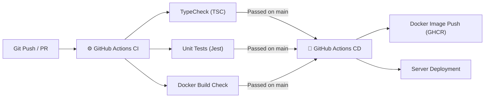

# 🚀 Igraem.kz — Руководство по CI/CD и развертыванию (Deployment Guide)

> **Система**: Continuous Integration & Continuous Deployment (CI/CD)  
> **Инструменты**: GitHub Actions, Docker, Docker Compose, GitHub Container Registry (GHCR), Prisma Migrations  

---

## 1. Обзор пайплайнов CI/CD

В проекте Igraem.kz настроены автоматизированные пайплайны GitHub Actions в директории `.github/workflows/`:



---

## 2. Пайплайны GitHub Actions

### 2.1. Continuous Integration (`.github/workflows/ci.yml`)
Запускается при коммитах в любые ветки (`main`, `master`, `feature/*`, `fix/*`) и Pull Request'ах:
* **Job 1: Lint & Type Check**:
  * Синтаксическая проверка и компиляция бэкенда (`npx tsc --noEmit`).
  * Сборка и проверка типов фронтенда (`npm --prefix client run build`).
* **Job 2: Backend Unit Tests**:
  * Запуск тестов проверки валидации ИИН (`iinValidator.test.ts`) и хелперов.
* **Job 3: Docker Build Check**:
  * Проверка собираемости Docker-образа в сухом режиме (`push: false`).

### 2.2. Continuous Deployment (`.github/workflows/cd.yml`)
Запускается автоматически при слиянии/коммите в ветку `main` или `master`:
1. Полная сборка клиентских и бэкенд ассетов.
2. Логин в GitHub Container Registry (`ghcr.io`).
3. Сборка и публикации Docker-образа `ghcr.io/tuleuov/igraem.kz:latest`.
4. Готовность к развертыванию на продуктовый сервер через SSH/Webhook.

---

## 3. Переменные окружения (Environment Variables)

Для работы приложения требуются следующие переменные (шаблон в `.env.example`):

```bash
# Сервер и Порт
PORT=3000
NODE_ENV=production

# База данных (SQLite / PostgreSQL)
DATABASE_URL="file:./dev.db"

# JWT Безопасность
JWT_SECRET=super_secret_jwt_key_igraem_kz_2026

# TTLock Smart Lock API
TTLOCK_CLIENT_ID=your_ttlock_client_id
TTLOCK_CLIENT_SECRET=your_ttlock_client_secret
```

---

## 4. Локальный запуск и Развертывание в Docker

### 4.1. Разработка с помощью Docker Compose
Для запуска полного окружения (бэкенд + БД + фронтенд):

```bash
docker-compose up --build -d
```

Приложение будет доступно по адресу:
* **Фронтенд & Приложение**: `http://localhost:5173/` (или `http://localhost:3000/`)
* **REST API**: `http://localhost:3000/api/v1`

### 4.2. Ручной локальный запуск (Без Docker)

```bash
# 1. Установка зависимостей бэкенда и фронтенда
npm install
npm --prefix client install

# 2. Инициализация базы данных Prisma
npx prisma db push
npx prisma db seed

# 3. Запуск сервера и клиенты в режиме разработки
npm run dev
```

---

## 5. Регламент ветвления и коммитов (Branching Model)

1. `main` / `master`: Защищенные ветки продуктового кода.
2. `feature/*`: Ветки новых фич (например, `feature/ttlock-offline-keys`).
3. `fix/*`: Ветки исправления ошибок.
4. **Формат коммитов**: Conventional Commits (например, `feat: add SMS OTP countdown timer`, `fix: update slot yellow badge styling`).
