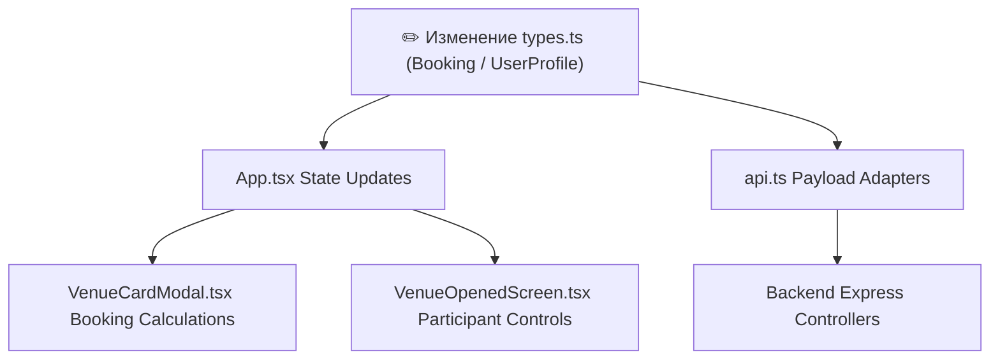

# 🔗 Матрица зависимостей и анализ влияния изменений (Dependency Matrix & Impact Analysis)

> **Цель**: Зафиксировать межмодульные зависимости в фронтенде и бэкенде.  
> **Использование**: При внесении изменений в модуль X обратитесь к данному документу, чтобы определить, какие связанные компоненты, типы, сервисы и файлы требуют обновления и тестирования.

---

## 1. Сводная матрица влияния изменений (Impact Matrix)

| Изменяемый модуль / Файл | Затрагиваемые компоненты | Затрагиваемые типы / API | Риски и области тестирования |
| :--- | :--- | :--- | :--- |
| **`client/src/types.ts`** | `App.tsx`, `AuthScreen.tsx`, `VenueCardModal.tsx`, `VenueOpenedScreen.tsx`, `BookingsTab.tsx`, `RequestsTab.tsx` | Все интерфейсы (`Booking`, `Venue`, `UserProfile`) | Разрыв контрактов типов TypeScript, ошибки обращений к свойствам в React компонентах. |
| **`client/src/services/api.ts`** | `App.tsx`, `AuthScreen.tsx`, `VenueCardModal.tsx`, `BookingSuccessScreen.tsx`, `VenueOpenedScreen.tsx` | `AuthResponse`, `GroundsResponse`, `BookingsResponse` | Ошибки сетевого взаимодействия, некорректная обработка ответов API бэкенда. |
| **`client/src/components/AuthScreen.tsx`** | `App.tsx` | `UserProfile`, `onSuccess` callback | Ошибки аутентификации, сбой передачи `phone_number` и ИИН при создании профиля. |
| **`client/src/components/VenueCardModal.tsx`** | `App.tsx`, `MapView.tsx`, `FavoritesTab.tsx` | `TimeSlot`, `onBook`, `isOccupied` | Сбой расчета лимита 3 часов, некорректное отображение жёлтых занятых слотов, сбой модалки присоединения. |
| **`client/src/components/VenueOpenedScreen.tsx`** | `App.tsx`, `BookingsTab.tsx`, `MapView.tsx` | `Booking`, `isParticipant`, `isOpened` | Сбой отображения таймера сессии (55 мин), разграничения кнопок «Завершить» / «Покинуть», модалки участников. |
| **`client/src/components/RequestsTab.tsx`** | `App.tsx`, `BottomNav.tsx` | `VenueIncomingRequests`, `requestsCount` | Сбой фильтрации слотов без запросов (`requests.length > 0`), некорректное вычисление счётчика на вкладе. |
| **`client/src/components/UnlockLoadingScreen.tsx`** | `App.tsx`, `VenueOpenedScreen.tsx` | `onComplete`, `unlockDoor` | Сбой физического отпирания смарт-замка, непереход в состояние `isOpened = true`. |
| **`src/controllers/authController.ts`** (Backend) | `src/routes/index.ts`, `client/src/services/api.ts` | JWT Token, `User` model in Prisma | Невозможность входа/регистрации, сбой проверки ИИН. |
| **`src/controllers/locksController.ts`** (Backend) | `src/services/ttlockService.ts`, `src/routes/index.ts` | `TTLock Cloud API` | Невозможность открыть смарт-замок, ошибки таймаута аппаратного ключа. |
| **`src/services/cronService.ts`** (Backend) | `prisma/schema.prisma`, `User` model | `is_banned`, `banned_until` | Ложные или непроработавшие баны пользователей при задержке на площадке > 5 мин. |

---

## 2. Детальный разбор связей по модулям

### 2.1. Модуль авторизации (`features/auth`)
* **Главный файл**: `client/src/components/AuthScreen.tsx`
* **Импортирует**: `Logo.tsx`, `services/api.ts`, `lucide-react`
* **Используется в**: `App.tsx` (включается, если `!isAuthenticated`)
* **Цепочка влияния**:
  1. При изменении полей в `AuthScreen.tsx` необходимо проверить структуру `UserProfile` в `client/src/types.ts` и `client/src/services/api.ts`.
  2. Изменения логики SMS OTP задевают серверный эндпоинт `POST /api/v1/auth/verify-otp` в `src/controllers/authController.ts`.

### 2.2. Модуль бронирования и смарт-замков (`features/booking`)
* **Главные файлы**: `VenueCardModal.tsx`, `VenueOpenedScreen.tsx`, `UnlockLoadingScreen.tsx`
* **Импортируют**: `types.ts`, `geo.ts`, `lucide-react`
* **Используются в**: `App.tsx`, `BookingsTab.tsx`, `MapView.tsx`
* **Цепочка влияния**:
  1. Изменение функции `handleSlotClick` или расчета `totalHours` в `VenueCardModal.tsx` напрямую влияет на колбэк `onBook` в `App.tsx` и подсчет занятых слотов.
  2. Изменение состояния `isParticipant` в `VenueOpenedScreen.tsx` влияет на текст кнопки (`«Завершить бронирование»` vs `«Покинуть площадку»`) и подтверждающий диалог.
  3. Команда завершения `handleCompleteBooking` вызывает `onFinishBooking` в `App.tsx`, что обновляет список `bookings`.

### 2.3. Модуль матчмейкинга и запросов (`features/requests`)
* **Главные файлы**: `RequestsTab.tsx`
* **Используется в**: `App.tsx`
* **Зависит от**: `incomingVenueRequests`, `myRequests` из состояния `App.tsx`
* **Цепочка влияния**:
  1. Логика фильтрации `filteredIncomingVenueRequests` проверяет `v.requests && v.requests.length > 0`. Если издать изменение в структуре `requests`, скрытие пустых слотов может сломаться.
  2. Кнопки `«Принять»` / `«Отклонить»` вызывают `onAcceptIncomingRequest` / `onDeclineIncomingRequest` в `App.tsx`, обновляя счётчик `totalPendingRequestsCount` в `BottomNav.tsx`.

---

## 3. Карты рисков при рефакторинге

---

## 4. Тестовое покрытие критических модулей (Test Coverage)

| Модуль / Утилита | Файл тестов | Покрываемый функционал | Статус Jest |
| :--- | :--- | :--- | :--- |
| **`src/utils/iinValidator.ts`** | `src/utils/iinValidator.test.ts` | Валидация 12-значного ИИН РК (длина, век/пол, дата, алгоритм Modulo 11), форматирование телефонов. | ✅ PASS (5/5) |
| **`src/services/ttlockService.ts`** | `src/services/ttlockService.test.ts` | Дистанционное отпирание замка TTLock Cloud, автопереход в автономный режим при сбое шлюза, статус шлюза. | ✅ PASS (3/3) |
| **`client/src/utils/geo.ts`** | `client/src/utils/geo.test.ts` | Расчет расстояний по формуле Гаверсинуса (Астана - Караганда), форматирование м/км для UI. | ✅ PASS (7/7) |

