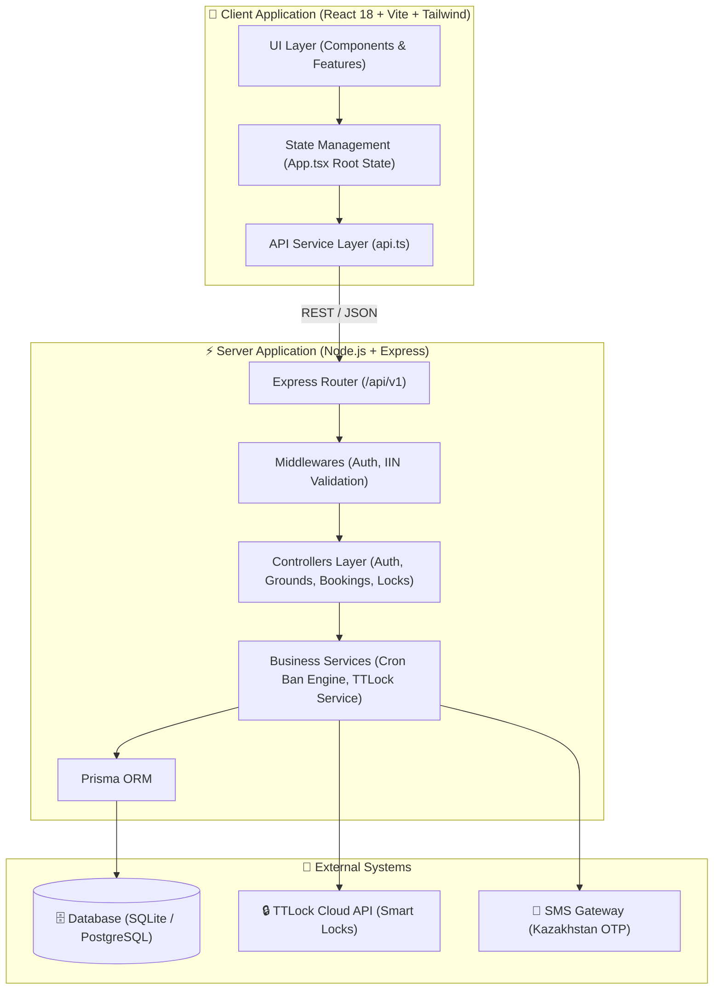

# 🏛️ Архитектура системы Igraem.kz (Architecture Overview)

> **Статус**: Архитектурная документация (Production Baseline)  
> **Проект**: Igraem.kz (Автоматизированная платформа аренды спортивных площадок и смарт-замков)  
> **Стек**: Node.js 20, Express, Prisma ORM, SQLite/PostgreSQL, React 18, Vite, Tailwind CSS, TTLock Cloud API, GitHub Actions CI/CD  

---

## 1. Высокоуровневый обзор системы

Платформа Igraem.kz представляет собой клиент-серверную систему для автономизации аренды любительских спортивных площадок (футбол, баскетбол) с управлением смарт-замками TTLock.



---

## 2. Используемый технологический стек

### 2.1. Backend (Серверная часть)
* **Рантайм**: Node.js (v20 LTS)
* **Фреймворк**: Express.js 4.x
* **Язык**: TypeScript 5.x
* **ORM & Database**: Prisma ORM 5.x (SQLite в dev-окружении, PostgreSQL в production)
* **Аутентификация**: JWT (JSON Web Tokens), `bcryptjs`
* **Фоновые задачи**: `node-cron` (автоматическая проверка истечения времени и начисление банов)

### 2.2. Frontend (Клиентская часть)
* **Фреймворк**: React 18 (SPA)
* **Сборщик**: Vite 5.x
* **Стилизация**: Tailwind CSS 3.x, Lucide React (иконки)
* **Язык**: TypeScript 5.x
* **Геолокация**: Browser HTML5 Geolocation API, утилита вычисления расстояния по формуле Гаверсинуса (`geo.ts`)

---

## 3. Ключевые компоненты и Модули

### 3.1. Модульная структура Фронтенда (`client/src/features/`)
```
client/src/
├── features/
│   ├── auth/          # AuthScreen.tsx, BannedUserScreen.tsx
│   ├── booking/       # BookingSuccessScreen.tsx, BookingsTab.tsx, UnlockLoadingScreen.tsx, VenueCardModal.tsx, VenueClosedModal.tsx, VenueOpenedScreen.tsx
│   ├── map/           # MapView.tsx, FilterBar.tsx, DateFilterModal.tsx
│   ├── requests/      # RequestsTab.tsx
│   ├── favorites/     # FavoritesTab.tsx
│   ├── profile/       # ProfileTab.tsx
│   └── layout/        # Header.tsx, BottomNav.tsx, Logo.tsx
```

### 3.2. Бэкенд контроллеры (`src/controllers/`)
* `authController.ts`: Обработка SMS OTP, проверка зарегистрированного номера, валидация ИИН и создание профиля.
* `groundsController.ts`: Выдача списка площадок, фильтрация по спорту/городу, занятые слоты.
* `bookingsController.ts`: Создание бронирований, проверка лимита 3 часов в день, отмена.
* `locksController.ts`: Отпирание смарт-замка TTLock и проверка прав доступа.
* `adminController.ts`: Мониторинг площадок и ручное управление банами.

---

## 4. Схема данных (Prisma Schema Overview)

```prisma
model User {
  id           String    @id @default(uuid())
  phone_number String    @unique
  full_name    String
  iin          String    @unique
  role         Role      @default(USER)
  is_banned    Boolean   @default(false)
  banned_until DateTime?
  created_at   DateTime  @default(now())

  bookings     Booking[]
  requests     Request[]
}

model Ground {
  id            String   @id @default(uuid())
  name          String
  type          SportType
  city          String
  address       String
  latitude      Float
  longitude     Float
  rating        Float    @default(5.0)
  lock_id       String?

  bookings      Booking[]
}

model Booking {
  id           String        @id @default(uuid())
  ground_id    String
  user_id      String
  booking_date String
  start_time   String
  end_time     String
  status       BookingStatus @default(UPCOMING)
  is_opened    Boolean       @default(false)

  ground       Ground        @relation(fields: [ground_id], references: [id])
  user         User          @relation(fields: [user_id], references: [id])
}
```

---

## 5. Внешние интеграции

1. **TTLock Cloud API**: Отправка команд разблокировки смарт-замков (`unlockDoor`) через OAuth2 авторизацию вендора.
2. **Алгоритмический валидатор ИИН РК (`iinValidator.ts`)**: Проверка 12-значного ИИН по контрольной сумме Республики Казахстан для предотвращения повторной регистрации забаненных пользователей.
3. **SMS Gateway**: Отправка 4-значных одноразовых кодов OTP на казахстанские номера (`+7 7XX XXX-XX-XX`).

---

## 6. Модель безопасности (Security Model & Data Protection)

### 6.1. Защита данных при передаче (Data in Transit)
* Весь сетевой трафик между клиентом React и REST API передается исключительно по защищенному протоколу **HTTPS (TLS 1.3 / 1.2)**.
* Аутентификация каждого API-запроса осуществляется передачей JWT-токена в заголовке `Authorization: Bearer <token>`.

### 6.2. Защита данных в покое (Data at Rest)
* Пароли пользователей хэшируются с использованием алгоритма `bcrypt` (с 10 раундами соли). Хранение паролей в открытом виде исключено.
* Чувствительные персональные данные (ИИН, номера телефонов) изолированы и не возвращаются в публичных методах API.

### 6.3. Предотвращение векторов атак (OWASP Hardening)
* **SQL Injection**: Использование ORM Prisma с параметризованными запросами исключает возможность внедрения SQL-кода.
* **IDOR (Insecure Direct Object References)**: Контроллеры бронирований и управления замками проверяют принадлежность `host_user_id` авторизованному `req.user.id`.
* **Управление секретами**: Конфигурационные ключи хранятся в переменных окружения (`.env`), которые исключены из репозитория через `.gitignore`.

