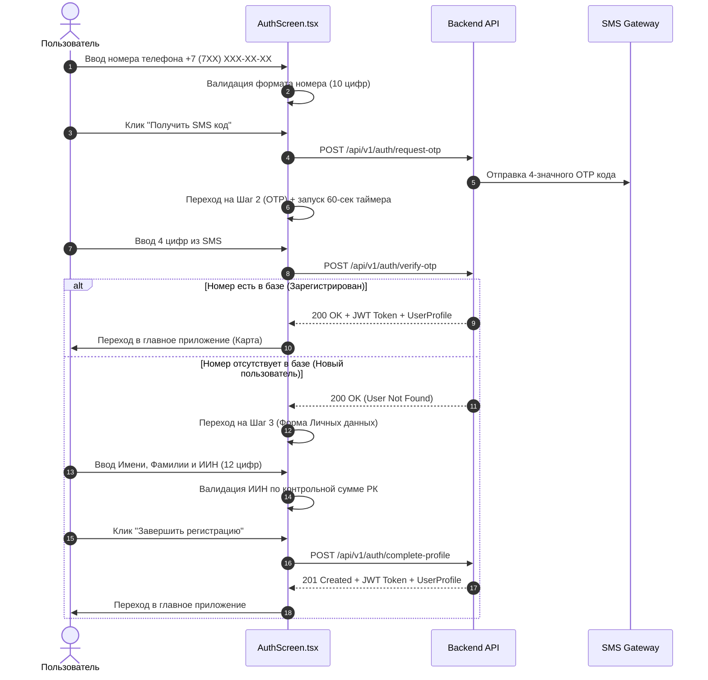

# 🔐 Бизнес-сценарий: Авторизация по SMS и Регистрация по ИИН

> **Модуль**: `features/auth` (`AuthScreen.tsx`)  
> **Цель**: Обеспечить быстрый беспарольный вход для существующих пользователей и обязательную регистрацию с проверкой ИИН для новых пользователей.

---

## 1. Описание сценария

Пользователь открывает приложение igraem.kz. Если он не авторизован, ему показывается экран ввода казахстанского номера телефона. Процесс разбит на 3 последовательных шага.

---

## 2. Шаги обработки (Flow Sequence)

---

## 3. Входные и Выходные данные

### Входные данные:
* `phoneDigits`: 10 цифр номера телефона РК.
* `otpDigits`: 4 цифры из SMS.
* `fullName`: Имя и Фамилия (при регистрации).
* `iin`: 12 цифр ИИН Республики Казахстан (при регистрации).

### Выходные данные:
* `userProfile`: Объект профиля пользователя (`id`, `full_name`, `phone_number`, `iin`, `role`).
* `token`: JWT-токен авторизации в `localStorage`.
