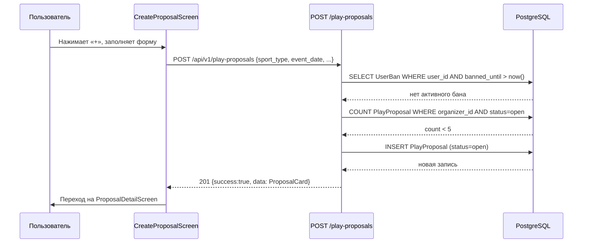
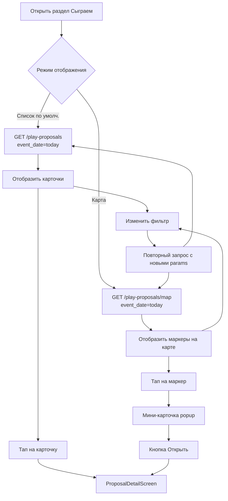
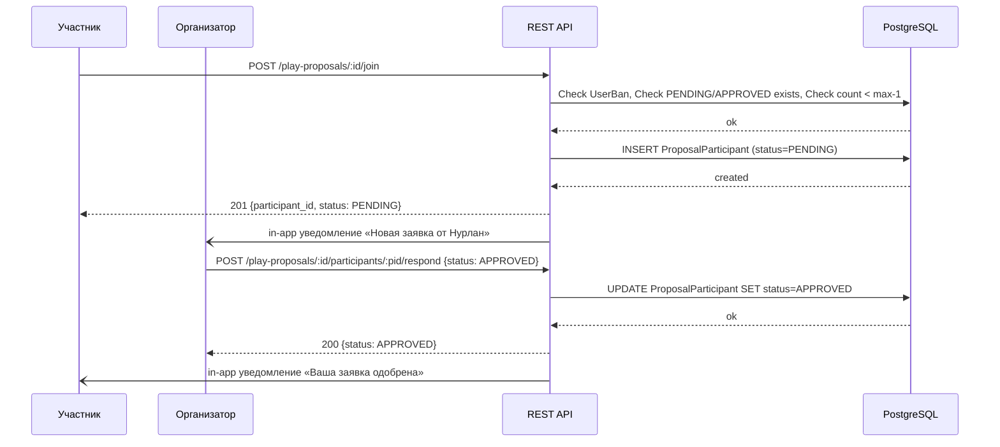
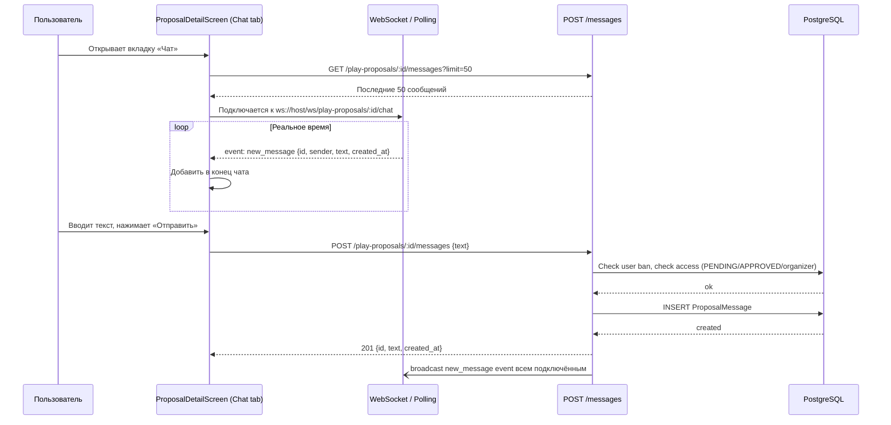
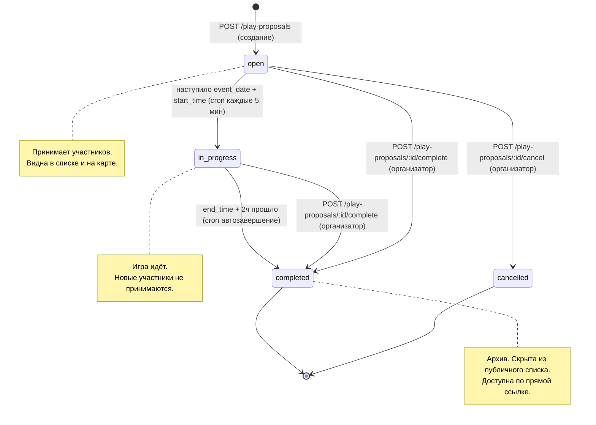
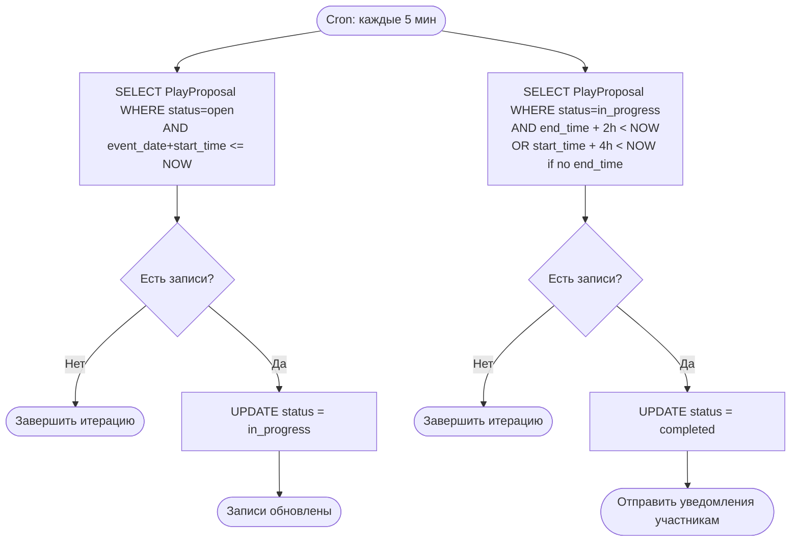
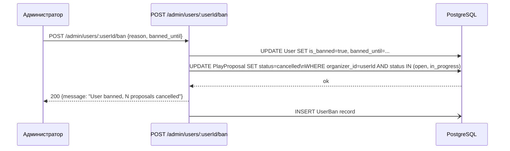
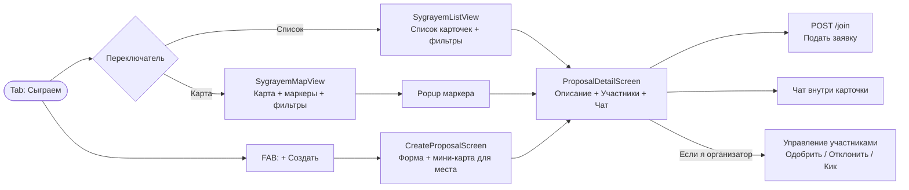

# 09-sygrayem / FLOWS.md
> SDD ref: SPEC-09 | Feature: «Сыграем» — Пользовательские сценарии и диаграммы

---

## Flow 1 — Создание заявки

### Шаги
1. Пользователь открывает раздел «Сыграем» → видит список/карту.
2. Нажимает «+» (FAB кнопка) → открывается `CreateProposalScreen`.
3. Заполняет форму: вид спорта, дата, время, место (из геолокации или ручной ввод + выбор на мини-карте), кол-во участников, комментарий.
4. Нажимает «Опубликовать» → POST `/api/v1/play-proposals`.
5. Сервер: проверяет бан → проверяет дату/время → проверяет лимит 5 заявок → создаёт запись → возвращает `ProposalCard`.
6. Клиент: перенаправляет на `ProposalDetailScreen` с только что созданной заявкой.

---

## Flow 2 — Просмотр раздела (список и карта)

### Шаги — Список
1. Пользователь открывает раздел → GET `/api/v1/play-proposals?event_date=today&page=1`.
2. Видит карточки с фильтром. Меняет фильтр → новый запрос с params.
3. Нажимает на карточку → `ProposalDetailScreen`.

### Шаги — Карта
1. Переключает режим на «Карта» → GET `/api/v1/play-proposals/map?event_date=today`.
2. Видит маркеры на карте. Меняет дату/фильтр → маркеры обновляются.
3. Тапает на маркер → всплывает мини-карточка → кнопка «Открыть» → `ProposalDetailScreen`.

---

## Flow 3 — Подача заявки на участие и одобрение

### Шаги
1. Пользователь просматривает заявку → видит «Хочу участвовать».
2. Нажимает → POST `/api/v1/play-proposals/:id/join`.
3. Сервер: проверяет бан → дублирование → `approved_count < max_participants - 1` → создаёт `ProposalParticipant(status=PENDING)`.
4. Организатор получает уведомление (in-app).
5. Организатор заходит в детальную карточку → видит вкладку «Заявки».
6. Нажимает «Одобрить» → POST `.../participants/:participantId/respond {status: APPROVED}`.
7. Участник получает уведомление об одобрении.

---

## Flow 4 — Чат внутри заявки

### Кто может писать
- Организатор: всегда (пока заявка не `cancelled`/`completed`).
- Участник со статусом `PENDING` или `APPROVED`: может писать.
- Участник со статусом `REJECTED` / `REMOVED`: только чтение истории.

---

## Flow 5 — Жизненный цикл статуса заявки

---

## Flow 6 — Автоматические переходы статусов (cron)

Cron-задача запускается каждые **5 минут**.

---

## Flow 7 — Бан пользователя и отмена его заявок

---

## UI-навигация раздела «Сыграем»

