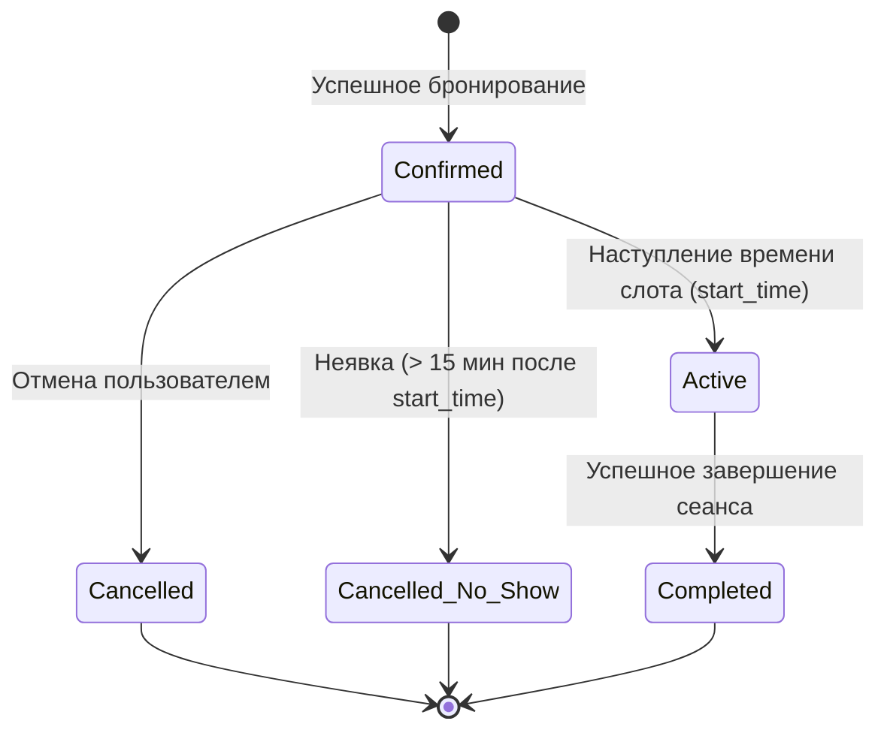

# 📅 SPEC-03: Движок Бронирования Слотов (Booking & Slot Engine Specification)

> **Модуль**: `features/booking`, `src/controllers/bookingsController.ts`, `client/src/components/VenueCardModal.tsx`  
> **Статус**: Действующая спецификация (Production Baseline)  
> **Инварианты**: [INV-01 (Суточный лимит 3 часа)](file:///Users/antontuleuov/.gemini/antigravity/scratch/igraem.kz/docs/sdd/00-system-invariants.md#inv-01-суточный-лимит-бронирования-max-3-hours-daily), [INV-05 (Запрет Overbooking)](file:///Users/antontuleuov/.gemini/antigravity/scratch/igraem.kz/docs/sdd/00-system-invariants.md#inv-05-атомарность-бронирования-слотов-anti-overlap), [INV-08 (Блокировка забаненных)](file:///Users/antontuleuov/.gemini/antigravity/scratch/igraem.kz/docs/sdd/00-system-invariants.md#inv-08-тотальная-блокировка-забаненного-профиля)

---

## 1. Обзор предметной области

Модуль управляет сеткой доступных временных интервалов, валидацией правил бронирования, суточным лимитом пользователя (не более 3 часов в день), атомарным предотвращением коллизий (двойных броней) и переключением слота в режим поиска сокомандников (Matchmaking).

---

## 2. Модель данных (Data Model)

```prisma
model Booking {
  id                     String         @id @default(uuid())
  ground_id              String
  ground                 Ground         @relation(fields: [ground_id], references: [id], onDelete: Cascade)
  host_user_id           String
  host_user              User           @relation("HostBookings", fields: [host_user_id], references: [id], onDelete: Cascade)
  booking_date           String         // 'YYYY-MM-DD'
  start_time             String         // 'HH:mm'
  end_time               String         // 'HH:mm'
  status                 String         @default("confirmed") // 'pending' | 'confirmed' | 'cancelled' | 'cancelled_no_show' | 'completed'
  payment_status         String         @default("paid")
  is_door_opened         Boolean        @default(false)
  total_price            Float
  invite_token           String         @unique @default(uuid())
  is_looking_for_players Boolean        @default(false)
  needed_players_count   Int            @default(0)
  auto_approve_players   Boolean        @default(false)
  created_at             DateTime       @default(now())

  guests                 BookingGuest[]
  joinRequests           JoinRequest[]
  lockLogs               LockLog[]
}
```

---

## 3. Функциональные требования (Requirements)

### REQ-BOOK-01: Генерация сетки слотов на 6 дней вперед
* **Описание**: Клиент формирует календарную сетку с шагом в 1 час (например, `08:00–09:00`, `09:00–10:00`, ..., `22:00–23:00`) на интервал «Сегодня» и 5 последующих календарных дней.
* **Критерии приемки**:
  - `Given`: Пользователь открывает модалку `VenueCardModal`.
  - `Then`: Доступны 6 кнопок выбора дат с указанием дня недели и числа (например, `Пн, 14 окт.`).
  - `When`: Выбрана дата.
  - `Then`: Загружаются все брони на этот день, и сетка слотов размечается на свободные и занятые.

### REQ-BOOK-02: Соблюдение суточного лимита в 3 часа на пользователя
* **Описание**: Суммарная продолжительность всех подтвержденных бронирований одного пользователя на одну и ту же дату не может превышать 3 часов (180 минут).
* **Критерии приемки**:
  - `Given`: У пользователя уже есть 2 забронированных часа на 15.10.2026.
  - `When`: Он пытается выбрать еще 2 часа на этот же день в модалке.
  - `Then`: Система блокирует подтверждение и отображает алерт: `«Максимальный лимит — не более 3 часов в день»`.
  - `When`: Сервер валидирует `POST /api/v1/bookings`.
  - `Then`: Если суммарная длительность превысит 3 часа, возвращается HTTP 400 Bad Request.

### REQ-BOOK-03: Стилизация и кликабельность занятых слотов
* **Описание**: Занятые слоты выделяются теплым желтым оттенком (`bg-[#FFF4E5] text-[#D97706]`). Они остаются кликабельными для отправки заявки организатору.
* **Критерии приемки**:
  - `Given`: Слот `18:00 - 19:00` уже забронирован другим пользователем.
  - `Then`: Отображается в желтом цвете с текстом времени и индикатором занятости.
  - `When`: Пользователь кликает по этому желтому слоту.
  - `Then`: Появляется информационный блок: *«Этот слот занят, но вы можете отправить запрос чтобы присоединиться к этой игре»*, а главная кнопка меняется на **«Присоединиться к игре»**.

### REQ-BOOK-04: Атомарность бронирования (Защита от Race Condition)
* **Описание**: Бронирование слота выполняется в единой изолированной транзакции базы данных.
* **Критерии приемки**:
  - `Given`: Два пользователя одновременно нажимают «Забронировать» на один и тот же слот `20:00–21:00`.
  - `Then`: Первый запрос успешно создает запись со статусом `confirmed`.
  - `Then`: Второй запрос откатывается с ошибкой HTTP 409 Conflict: `«Выбранный временной слот уже занят другим игроком»`.

### REQ-BOOK-05: Отмена бронирования (Cancellation Policy)
* **Описание**: Организатор может отменить свою предстоящую бронь.
* **Критерии приемки**:
  - `Given`: Предстоящая бронь в статусе `confirmed`.
  - `When`: Пользователь нажимает «Отменить бронирование» и подтверждает действие.
  - `Then`: Статус меняется на `cancelled`, слот освобождается в сетке для других игроков.

---

## 4. Диаграмма состояний бронирования (State Diagram)



---

## 5. Спецификация API Контрактов

### Создание бронирования (`POST /api/v1/bookings`)
```json
// Request
{
  "ground_id": "ground-uuid-1",
  "booking_date": "2026-10-15",
  "start_time": "18:00",
  "end_time": "19:00"
}

// Response 201 Created
{
  "success": true,
  "data": {
    "id": "booking-uuid-123",
    "status": "confirmed",
    "total_price": 0,
    "invite_token": "inv-token-abc",
    "booking_date": "2026-10-15",
    "start_time": "18:00",
    "end_time": "19:00"
  }
}
```

---

## 6. Стратегия тестирования

| Требование | Название теста | Файл теста |
| :--- | :--- | :--- |
| **REQ-BOOK-02** | `Rejects booking if user exceeds 3 hours per day limit` | `src/controllers/bookingsController.test.ts` |
| **REQ-BOOK-04** | `Prevents double booking on overlapping slot with 409 Conflict` | `src/controllers/bookingsController.test.ts` |
| **REQ-BOOK-05** | `Cancels upcoming booking and frees slot` | `src/controllers/bookingsController.test.ts` |
