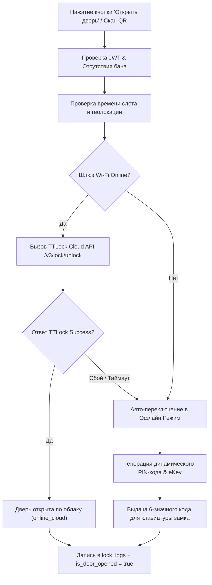

# 🔒 SPEC-04: Управление Смарт-Замками TTLock (Smart Locks & Access Control)

> **Модуль**: `features/booking`, `src/services/ttlockService.ts`, `src/controllers/locksController.ts`  
> **Статус**: Действующая спецификация (Production Baseline)  
> **Инварианты**: [INV-04 (Отказоустойчивость доступа)](file:///Users/antontuleuov/.gemini/antigravity/scratch/igraem.kz/docs/sdd/00-system-invariants.md#inv-04-отказоустойчивость-доступа-к-смарт-замку-ttlock-failover), [INV-08 (Блокировка забаненных)](file:///Users/antontuleuov/.gemini/antigravity/scratch/igraem.kz/docs/sdd/00-system-invariants.md#inv-08-тотальная-блокировка-забаненного-профиля)

---

## 1. Обзор предметной области

Модуль обеспечивает бесконтактный физический доступ на спортивные площадки через интеграцию с экосистемой смарт-замков **TTLock**. Реализована гибридная архитектура доступа: основной канал — дистанционное открытие через облачный шлюз Wi-Fi/5G; резервный канал — автономная генерация 6-значных временных PIN-кодов и Bluetooth eKey токенов при отсутствии связи.

---

## 2. Модель данных (Data Model)

```prisma
model Gateway {
  id                String   @id @default(uuid())
  ground_id         String
  ground            Ground   @relation(fields: [ground_id], references: [id], onDelete: Cascade)
  gateway_name      String
  ttlock_gateway_id String   @unique
  status            String   @default("online") // 'online' | 'offline'
  last_ping_at      DateTime @default(now())
  created_at        DateTime @default(now())

  logs GatewayStatusLog[]
}

model LockLog {
  id          String   @id @default(uuid())
  booking_id  String?
  booking     Booking? @relation(fields: [booking_id], references: [id], onDelete: SetNull)
  user_id     String
  user        User     @relation(fields: [user_id], references: [id], onDelete: Cascade)
  ground_id   String
  ground      Ground   @relation(fields: [ground_id], references: [id], onDelete: Cascade)
  method      String   // 'app_button' | 'qr_code'
  unlock_type String   // 'online_cloud' | 'offline_passcode' | 'offline_ekey'
  success     Boolean
  details     String?
  created_at  DateTime @default(now())
}
```

---

## 3. Функциональные требования (Requirements)

### REQ-LOCK-01: Дистанционное открытие через TTLock Cloud API
* **Описание**: При наличии активной брони и онлайн-статуса шлюза сервер отправляет команду `/v3/lock/unlock` в TTLock Cloud OpenAPI.
* **Критерии приемки**:
  - `Given`: Пользователь находится в радиусе до 50 метров от площадки во время своего забронированного слота.
  - `When`: Нажимает кнопку «Открыть дверь» в приложении.
  - `Then`: Сервер получает валидный OAuth-токен TTLock, отправляет POST-запрос разблокировки, физический замок издает сигнал открытия, и статус брони меняется на `is_door_opened = true`.

### REQ-LOCK-02: Автономный аварийный режим (Offline Fallover)
* **Описание**: Если Wi-Fi шлюз площадки отключен (`status = 'offline'`) или сеть недоступна, сервер мгновенно генерирует циклический 6-значный клавиатурный код (PIN) и Bluetooth eKey токен.
* **Критерии приемки**:
  - `Given`: Шлюз площадки перешел в статус `offline`.
  - `When`: Пользователь запрашивает отпирание двери.
  - `Then`: Система не выдает ошибку, а возвращает успешный ответ с типом `offline_passcode`: отображается 6-значный PIN-код для клавиатуры замка с инструкцией: *«Связь со шлюзом отсутствует. Введите код на сенсорной панели замка: 123456#»*.

### REQ-LOCK-03: Фоновый мониторинг здоровья шлюзов (Gateway Health Cron)
* **Описание**: Сервер регулярно опрашивает состояние шлюзов площадок с записью в историю `GatewayStatusLog`.
* **Критерии приемки**:
  - `Given`: Настроенный крон-интервал (по умолчанию каждые 3 минуты).
  - `When`: Крон-задача `initGatewayMonitoring` запускается.
  - `Then`: Опрашивается API TTLock `/v3/gateway/list`, обновляется колонка `status` в таблице `gateways` и создается запись лога с временной меткой.

### REQ-LOCK-04: Анимированный экран открытия двери (`UnlockLoadingScreen.tsx`)
* **Описание**: Процесс отпирания сопровождается 3-стадийной визуализацией:
  1. *«Проверка прав доступа и геопозиции...»* (пульсирующие кольца).
  2. *«Отправка цифрового ключа на смарт-замок...»*.
  3. *«Дверь разблокирована! Проходите на площадку»* (индикатор 100%, переход на экран сессии).

### REQ-LOCK-05: Журналирование попыток входа (Audit Lock Logs)
* **Описание**: Каждая попытка открытия фиксируется в таблице `lock_logs` с указанием пользователя, площадки, метода (`app_button`/`qr_code`), типа (`online_cloud`/`offline_passcode`) и результата.

---

## 4. Схема работы гибридного доступа (Flowchart)



---

## 5. Стратегия тестирования

| Требование | Название теста | Файл теста |
| :--- | :--- | :--- |
| **REQ-LOCK-01** | `Unlocks door remotely via cloud when gateway is online` | `src/services/ttlockService.test.ts` |
| **REQ-LOCK-02** | `Switches to offline passcode mode when gateway is offline` | `src/services/ttlockService.test.ts` |
| **REQ-LOCK-05** | `Creates audit entry in lock_logs table for every attempt` | `src/controllers/locksController.test.ts` |
