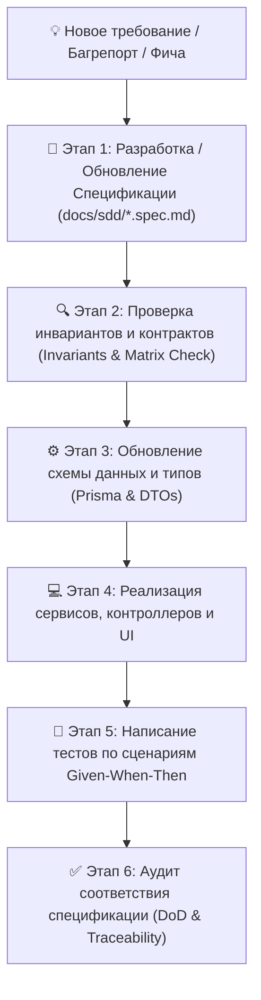

# 📘 Регламент Spec-Driven Development (SDD) — Igraem.kz

> **Методология**: Spec-Driven Development (Разработка на основе спецификаций)  
> **Проект**: Igraem.kz (Автоматизированная платформа аренды спортивных площадок и смарт-замков)  
> **Версия спецификаций**: 3.0.0 (Production Core Baseline)  
> **Статус**: Действующий единый источник истины (Single Source of Truth — SSOT)

---

## 1. Манифест SDD в проекте Igraem.kz

**Spec-Driven Development (SDD)** — это инженерный подход, при котором **структурированная спецификация является высшим источником истины** как для инженеров-людей, так и для автономных ИИ-агентов. 

### Базовые аксиомы:
1. **Код вторичен по отношению к спецификации.** Код — это всего лишь исполняемая проекция спецификации в конкретный стек (Node.js/React/PostgreSQL).
2. **Тесты выводятся из спецификации.** Каждый тестовый сценарий (Unit, Integration, E2E) обязан быть привязан к конкретному критерию приемки (Acceptance Criteria) из соответствующей спеки.
3. **Запрет недокументированного кода.** Ни одна строчка бизнес-логики, ни один эндпоинт, ни одна колонка БД не могут появиться в коде без предварительного описания в соответствующей спецификации.
4. **Каскадная синхронизация.** Изменение требований сначала вносится в спеку, согласуется, и только затем транслируется в схему Prisma, контроллеры, клиентские типы, UI-компоненты и тесты.

---

## 2. Жизненный цикл разработки по SDD (The SDD Loop)

### Фазы процесса:
* **Этап 1 (Spec First)**: Автор формулирует функциональные требования с уникальными идентификаторами (`REQ-XXX`), контракты API, состояния и граничные случаи.
* **Этап 2 (Invariant Check)**: Спецификация сверяется с [Системными инвариантами](file:///Users/antontuleuov/.gemini/antigravity/scratch/igraem.kz/docs/sdd/00-system-invariants.md). Не допускается нарушение фундаментальных правил (лимит 3 часов, авто-бан через 5 минут, валидация ИИН и т.д.).
* **Этап 3 (Data Contracts)**: Обновляются типы TypeScript, схемы Prisma и валидаторы (Zod).
* **Этап 4 (Implementation)**: Пишется чистый код серверной и клиентской логики.
* **Этап 5 (Verification)**: Реализуются тесты, дословно повторяющие Given-When-Then сценарии спецификации.
* **Этап 6 (Traceability)**: Обновляется [Матрица трассируемости](file:///Users/antontuleuov/.gemini/antigravity/scratch/igraem.kz/docs/sdd/09-traceability-matrix.md).

---

## 3. Реестр спецификаций системы (SDD Specification Index)

| ID | Спецификация | Область ответственности | Файл спецификации |
| :---: | :--- | :--- | :--- |
| **INV** | **Системные инварианты** | Непреложные правила целостности платформы | [00-system-invariants.md](file:///Users/antontuleuov/.gemini/antigravity/scratch/igraem.kz/docs/sdd/00-system-invariants.md) |
| **SPEC-01** | **Идентификация и Доступ (Auth & Identity)** | SMS OTP, алгоритм проверки ИИН РК, JWT, RBAC | [01-auth-and-identity.spec.md](file:///Users/antontuleuov/.gemini/antigravity/scratch/igraem.kz/docs/sdd/01-auth-and-identity.spec.md) |
| **SPEC-02** | **Каталог площадок и Геолокация (Venues)** | Спортивные объекты, школы, координаты, радиус, расписание | [02-venues-and-catalog.spec.md](file:///Users/antontuleuov/.gemini/antigravity/scratch/igraem.kz/docs/sdd/02-venues-and-catalog.spec.md) |
| **SPEC-03** | **Движок бронирования слотов (Booking Engine)** | Генерация слотов, лимит 3ч, транзакции, оплата, отмены | [03-booking-and-slot-engine.spec.md](file:///Users/antontuleuov/.gemini/antigravity/scratch/igraem.kz/docs/sdd/03-booking-and-slot-engine.spec.md) |
| **SPEC-04** | **Управление смарт-замками (TTLock Access)** | Облачный замок, Bluetooth eKey, PIN-код, шлюзы, мониторинг | [04-smart-locks-ttlock.spec.md](file:///Users/antontuleuov/.gemini/antigravity/scratch/igraem.kz/docs/sdd/04-smart-locks-ttlock.spec.md) |
| **SPEC-05** | **Сессия игры и Защита от задержек (Overstay & Ban)** | Таймер 55 мин, продление, 5-мин грейс, авто-бан 3 дня, апелляции | [05-session-and-overstay-ban.spec.md](file:///Users/antontuleuov/.gemini/antigravity/scratch/igraem.kz/docs/sdd/05-session-and-overstay-ban.spec.md) |
| **SPEC-06** | **Матчмейкинг и Совместные игры (Matchmaking)** | Открытые матчи, заявки, подтверждение, ростер, QR ворот | [06-matchmaking-and-social.spec.md](file:///Users/antontuleuov/.gemini/antigravity/scratch/igraem.kz/docs/sdd/06-matchmaking-and-social.spec.md) |
| **SPEC-07** | **Администрирование и Аналитика Акимата (Analytics)** | Панель акимата, тепловые карты, мониторинг шлюзов, ручные баны | [07-admin-and-akimat-analytics.spec.md](file:///Users/antontuleuov/.gemini/antigravity/scratch/igraem.kz/docs/sdd/07-admin-and-akimat-analytics.spec.md) |
| **SPEC-08** | **Контракты REST API (API Specifications)** | Полная спецификация эндпоинтов, DTO, схемы ошибок | [08-api-contracts.spec.md](file:///Users/antontuleuov/.gemini/antigravity/scratch/igraem.kz/docs/sdd/08-api-contracts.spec.md) |
| **SPEC-09** | **Матрица трассируемости (Traceability Matrix)** | Связи требований: Спека ↔ Код ↔ Тесты | [09-traceability-matrix.md](file:///Users/antontuleuov/.gemini/antigravity/scratch/igraem.kz/docs/sdd/09-traceability-matrix.md) |

---

## 4. Стандарт оформления спецификаций (SDD Template)

Каждая спецификация в `docs/sdd/` строится по единому унифицированному стандарту:
1. **Metadata & Status**: Версия, статус, авторство, доменная область.
2. **System Invariants Impact**: Ссылка на затрагиваемые системные инварианты.
3. **Domain Entities & Data Dictionary**: Описание сущностей, полей, типов и ограничений.
4. **Requirements (REQ-xxx)**:
   - *Title & Description*
   - *Input / Output Contracts*
   - *Acceptance Criteria (Gherkin: Given / When / Then)*
   - *Edge Cases & Error Handling*
5. **State Machine / Flow Diagrams**: Визуальные диаграммы перехода состояний в формате Mermaid.
6. **Verification & Test Strategy**: Конкретные юнит- и интеграционные тесты, доказывающие соответствие спеке.
